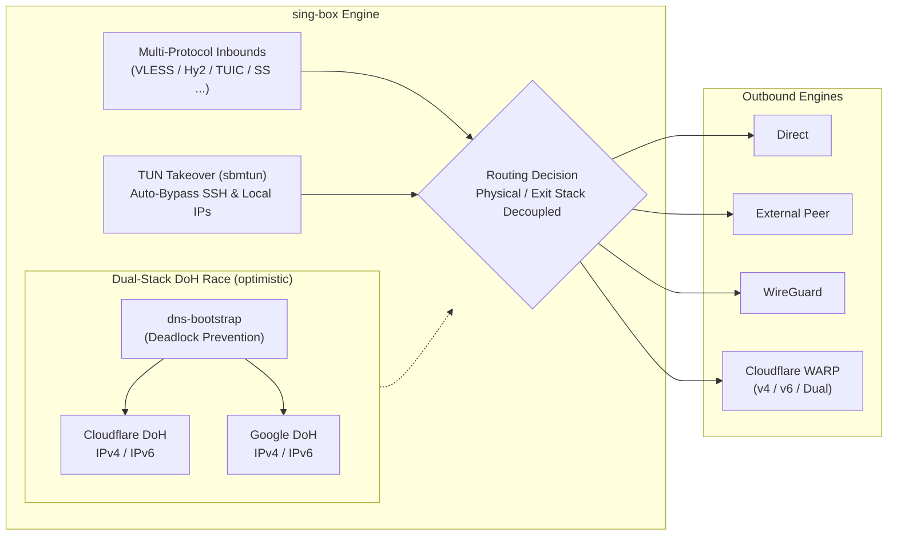

<div align="center">


# S-Singbox-Manager


**Pure Bash Single-File · Full-Featured Interactive sing-box Manager**


[](https://github.com/88860/S-Singbox-Manager)
[](https://www.gnu.org/software/bash/)
[](https://github.com/SagerNet/sing-box)
[](#quick-start)
[](#architecture--security-highlights)


[简体中文](README.md) | **English**


[Quick Start](#quick-start) · [Core Features](#core-features) · [Protocol Matrix](#protocol-matrix) · [Architecture & Security](#architecture--security-highlights) · [Operations & Layout](#operations--layout)


</div>


---


## Overview


`S-Singbox-Manager` (CLI shortcut: `s`) is a pure Bash, single-file interactive operations manager built around **sing-box**. It integrates **multi-protocol server management, transparent TUN global takeover, userspace WireGuard tunnels, Cloudflare WARP exit routing, and automated ACME certificate issuance** with strict transactional rollbacks and supply-chain integrity verification.


> [!IMPORTANT]
> **Requirements**: **Root privileges** on **Debian / Ubuntu** (`apt` + `systemd`). Natively supports IPv4-only, IPv6-only, and Dual-Stack hosts.


---


## Quick Start


### One-Line Install & Run


```bash
curl -fsSL [https://raw.githubusercontent.com/88860/S-Singbox-Manager/main/s.sh](https://raw.githubusercontent.com/88860/S-Singbox-Manager/main/s.sh) -o /root/s.sh && chmod 700 /root/s.sh && bash /root/s.sh
```


On first launch, the script installs missing dependencies, fetches the latest architecture-matched `sing-box` binary (with mandatory SHA-256 verification), configures the `systemd` unit, and registers the global shortcut `/usr/local/bin/s`.


### CLI Quick Reference


| Command | Description |
| :--- | :--- |
| `s` | Launch the interactive main menu |
| `s -v` / `s --version` | Display the current script version (e.g., `s v26.11.27`) |


---


## Core Features


* **Multi-Protocol Server Management**: Create, delete, and hot-edit 9 protocol families / 15 transport combinations. Automatically generates standard share URIs using your bound domain or physical NIC public IPv4 / IPv6 addresses.
* **Client & Transparent TUN Takeover**: Import external nodes via standard URIs with strict anti-loopback validation (blocking loopback and local NIC/public IPs) and concurrent dual-stack latency probing. Routes host traffic transparently through `sbmtun` while syncing `systemd-resolved` default routes.
* **Userspace WireGuard**: Built-in userspace WireGuard (MTU `1408`) supporting both **Server mode** (multi-client management with automatic dual-stack subnet allocation and conflict detection) and **Client mode** (global exit takeover with tunnel latency probing).
* **Cloudflare WARP Exit**: One-click free registration and token refresh with automatic `client_id` → `reserved` byte extraction. Supports independent **IPv4 / IPv6 / Dual-Stack** takeover, dual-stack endpoint fallback, and live `cdn-cgi/trace` verification (auto-rollback on failure).
* **Monitoring & Lifecycle**: Displays system telemetry, core version, and dual-stack exit IP / Geo / ASN. Supports online updates for both `sing-box` and `s.sh`, plus clean uninstallation tracking script-installed `apt` packages.


---


## Protocol Matrix


### Server Inbound Protocols


| Protocol | Supported Variants / Features | Transport | TLS / Security |
| :--- | :--- | :--- | :--- |
| **VLESS** | Reality (`xtls-rprx-vision`), TLS (`xtls-rprx-vision`), WS + TLS, gRPC + TLS | TCP | Auto-probes Reality target for TLS 1.3 / h2 / X25519; ACME for others |
| **Trojan** | TLS, WebSocket + TLS, gRPC + TLS | TCP | Automated ACME |
| **Hysteria2** | BBR (`conservative`/`standard`/`aggressive`) or Brutal bandwidth; Salamander / Gecko obfs (512–2048B); `nftables` port hopping | UDP | Automated ACME + ALPN `h3` |
| **TUIC** | v5, `bbr`/`cubic`/`new_reno` congestion control, `native` UDP relay | UDP | Automated ACME + ALPN `h3` |
| **Shadowsocks** | 2022 (`AES-128-GCM` / `AES-256-GCM` / `ChaCha20-Poly1305`) & classic AEAD, Multiplex enabled | TCP + UDP | Strict key length validation |
| **VMess** | TLS, WebSocket + TLS, gRPC + TLS, HTTP + TLS | TCP | Automated ACME |
| **AnyTLS** | Standard TLS + optional `client_metadata` | TCP | Automated ACME |
| **SOCKS5** | Username / password authentication | TCP | Auth credentials |
| **Snell** | v6, custom PSK (12–255 bytes), traffic shaping (`default` / `unshaped` / `unsafe-raw`) | TCP | Pre-Shared Key (PSK) |


### ACME Challenge Providers


| Method | Port Requirement | Use Case |
| :--- | :--- | :--- |
| **HTTP-01** | TCP `80` open | Recommended for quick single-domain issuance |
| **TLS-ALPN-01** | TCP `443` open | Recommended when port 80 is unavailable |
| **Cloudflare DNS** | None | Uses Cloudflare API Token (no public HTTP required) |
| **AliDNS** | None | Uses Aliyun AccessKeyId / AccessKeySecret |
| **ACME-DNS** | None | Uses self-hosted or third-party ACME-DNS credentials |


---


## Architecture & Security Highlights





* **Native Dual-Stack & DoH Racing**: Uses `dns-bootstrap` to eliminate resolution deadlocks while racing Cloudflare and Google DoH over IPv4/IPv6 (`optimistic: true`, 3s timeout), cleanly decoupling the physical host stack from the proxy exit stack.
* **Zero-Downtime Domain Migration**: Switching domains spawns an isolated temporary `sing-box` instance to pre-issue and verify the new certificate (checking public/private key match and expiry) before atomically cutting over; failures roll back losslessly.
* **SSH Anti-Lockout Guard**: Enabling global TUN takeover automatically bypasses the active SSH client IP, local SSH listening ports, `sshd`/`dropbear` processes, and local interface addresses.
* **Atomic Transactions & Rollbacks**: Protected by `flock` config locking, `sing-box check` pre-validation, and atomic `0600` temp-file replacement. Service startup failures automatically restore the previous config and port-hopping rules.
* **Supply-Chain Integrity**: `sing-box` core downloads enforce GitHub Release **SHA-256** verification; script self-updates verify **Git Commit Ref + Git Blob SHA-1 + `bash -n`** before replacing the executable.
* **Least Privilege & Zero Log Bloat**: `systemd` grants only required Capabilities with `NoNewPrivileges=true`. No persistent disk logs are written by the script; runtime logs are delegated to `systemd-journald` for automatic rotation.


---


## Operations & Layout


<details>
<summary><b>Expand: Full Interactive Menu Structure</b></summary>


```text
s Manager v26.11.27
├── 1. Server Management
│   ├── 1. Create Protocol (VLESS / Trojan / Hysteria2 / TUIC / Shadowsocks / VMess / AnyTLS / SOCKS5 / Snell)
│   ├── 2. Delete Protocol (optionally cleans domain & certs when no ACME nodes remain)
│   ├── 3. Modify Config (name / port / credentials / transport / CC / obfs / port hopping)
│   ├── 4. Server Info (listening status, dual-stack/domain URIs, cert expiry)
│   ├── 5. Change Domain (isolated pre-issuance + automatic rollback)
│   ├── 6. Restart Service
│   └── 7. Stop Service
├── 2. Client Management
│   ├── 1. Add Node (URI parser + anti-loopback + sing-box check)
│   ├── 2. Select Node (concurrent dual-stack latency probe + TUN takeover)
│   ├── 3. Delete Node
│   ├── 4. Stop Proxy (restore direct)
│   └── 5. Client Status (active exit + dual-stack IP / Geo / ASN)
├── 3. WireGuard Management
│   ├── 1. Initialize Config (Server / Client)
│   ├── 2. Modify Config (clients / port / tunnel dual-stack IPs / remote peer)
│   ├── 3. Enable / Disable
│   ├── 4. Status Info
│   └── 5. Delete Config
├── 4. WARP Management
│   ├── 1. Fetch Exit IP (IPv4 / IPv6 / Dual-Stack)
│   ├── 2. View WARP Status
│   ├── 3. Enable / Disable WARP
│   └── 4. Delete Config (with remote deregistration)
└── 5. Status & Updates
    ├── 1. Unlock Check (Dual-stack AI / Streaming / Popular CDNs)
    ├── 2. Check Updates (sing-box core + s.sh script)
    └── 3. Uninstall (cleans service, nftables rules, configs & optional apt packages)
```


</details>


<details>
<summary><b>Expand: Core Files & Directory Layout</b></summary>


| Path | Purpose |
| :--- | :--- |
| `/root/s.sh` | Main script (`0700`) |
| `/usr/local/bin/s` | Global CLI symlink |
| `/usr/local/bin/sing-box` | sing-box core binary |
| `/etc/sing-box/config.json` | Generated runtime config (`0600`) |
| `/etc/sbm/nodes/*.json` | Server inbound node metadata |
| `/etc/sbm/peers/*.json` | Client outbound peer configs |
| `/etc/sbm/wg/local.json` | Local WireGuard configuration |
| `/etc/sbm/warp/config.json` | Cloudflare WARP registration & runtime state |
| `/etc/sbm/acme/` | ACME certificate storage |
| `/etc/sbm/state.json` | Global exit state, domain, and ACME challenge settings |
| `/etc/sbm/apt_installed` | List of script-installed `apt` packages for clean removal |
| `/etc/systemd/system/sing-box.service` | systemd service unit (with Drop-in hooks) |


</details>


<details>
<summary><b>Expand: Viewing Logs & Tuning journald Limits</b></summary>


Follow live `sing-box` logs:
```bash
journalctl -u sing-box -f --no-pager
```


Cap `systemd-journald` disk usage to `50M` / `7 days` on small-disk VPS instances:
```bash
mkdir -p /etc/systemd/journald.conf.d
cat > /etc/systemd/journald.conf.d/size.conf <<'EOF'
[Journal]
SystemMaxUse=50M
MaxRetentionSec=7day
EOF
systemctl restart systemd-journald
```


</details>


> [!TIP]
> To completely remove the tool and all configurations, select **`5. Status & Updates` → `3. Uninstall`** from the menu. It stops the service, flushes `nftables` hopping rules, removes config directories, and prompts to remove script-installed dependencies.

