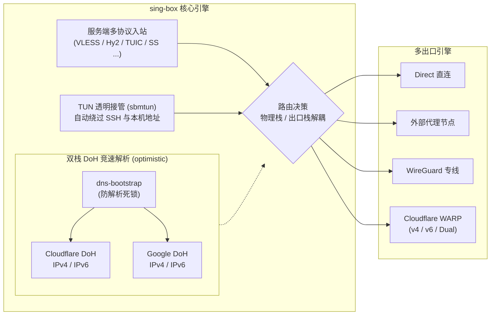

&lt;div align=&quot;center&quot;&gt;


# S-Singbox-Manager


**纯 Bash 单文件 · 全功能 sing-box 交互式运维管理器**


[](https://github.com/88860/S-Singbox-Manager)
[](https://www.gnu.org/software/bash/)
[](https://github.com/SagerNet/sing-box)
[](#快速开始)
[](#架构与安全亮点)


**简体中文** | [English](readme_en.md)


[快速开始](#快速开始) · [核心功能](#核心功能) · [协议支持矩阵](#协议支持矩阵) · [架构与安全亮点](#架构与安全亮点) · [目录与运维](#目录与运维)


&lt;/div&gt;


---


## 项目简介


`S-Singbox-Manager`（快捷命令 `s`）是一款基于 **sing-box** 内核、纯 Bash 编写的单文件交互式运维脚本。集 **多协议服务端管理、客户端全局 TUN 透明接管、用户态 WireGuard 专线、Cloudflare WARP 出口接管、全自动 ACME 证书签发** 于一体，内置强事务回滚与供应链完整性校验，开箱即用且不污染宿主机环境。


> [!IMPORTANT]
> **运行环境要求**：需具备 **Root 权限**，运行于基于 `apt` 与 `systemd` 的 **Debian / Ubuntu** 系统，`sing-box` 内核 ≥ `v1.14.0`（首次运行自动安装最新版），兼容纯 IPv4、纯 IPv6 及双栈网络。


---


## 快速开始


### 一键拉取并运行


```bash

curl -fsSL https://raw.githubusercontent.com/88860/S-Singbox-Manager/main/s.sh -o /root/s.sh && chmod 700 /root/s.sh && bash /root/s.sh

```


首次运行将自动检测并补齐必要依赖、下载对应架构的最新版 `sing-box` 内核（强制 SHA-256 校验）、注册 `systemd` 服务并创建全局快捷命令 `/usr/local/bin/s`。


### 日常命令速查


| 命令 | 说明 |
| :--- | :--- |
| `s` | 唤起交互式主菜单 |
| `s -v` / `s --version` | 查看当前脚本版本（如 `s v26.11.28`） |


---


## 核心功能


* **服务端多协议管理**：支持 9 大类 / 15 种协议与传输组合的创建、删除与参数热修改；自动按绑定域名或物理网卡公网 IPv4 / IPv6 生成标准分享链接。
* **客户端与 TUN 透明接管**：支持主流协议分享链接（URI）一键导入、严格防自环校验（自动拦截回环与本机公网/内网 IP）、并发双栈延迟探测；通过 `sbmtun` 虚拟网卡实现全局透明接管，同步接管 `systemd-resolved` 默认路由。
* **WireGuard 专线**：内置用户态 WireGuard（MTU `1408`），支持**服务端模式**（多客户端管理、自动双栈网段分配与地址冲突检测）与**客户端模式**（全局出口接管、隧道内网延迟探测）。
* **Cloudflare WARP 出口**：一键免费注册与凭据刷新，自动提取 `client_id` 对应 `reserved` 字节；支持 **IPv4 / IPv6 / 双栈**独立接管，内置端点双栈自动回退与 `cdn-cgi/trace` 实测校验（未接管成功自动回滚）。
* **解锁检测与生命周期管理**：双栈并发检测 14 项目标（AI：ChatGPT / Claude / Gemini / Grok；流媒体：Netflix / Disney+ / YouTube Premium / Spotify；CDN：YouTube / Cloudflare / CloudFront / Fastly / Bunny / Gcore）；实时展示系统资源与出口 IP / 地区 / ASN；支持内核与脚本在线更新及一键彻底卸载。


---


## 协议支持矩阵


### 服务端入站协议


| 协议大类 | 支持组合 / 特性 | 传输层 / 端口 | 证书 / 安全机制 |
| :--- | :--- | :--- | :--- |
| **VLESS** | Reality (`xtls-rprx-vision`)、TLS (`xtls-rprx-vision`)、WS + TLS、gRPC + TLS | TCP | Reality 自动探测目标域名 TLS 1.3 / h2 / X25519；其余走 ACME |
| **Trojan** | TLS、WebSocket + TLS、gRPC + TLS | TCP | ACME 自动证书 |
| **Hysteria2** | BBR (`conservative`/`standard`/`aggressive`) / Brutal 手动带宽；Salamander / Gecko 混淆（包长 512–2048）；`nftables` 端口跳跃 | UDP | ACME 自动证书 + ALPN `h3` |
| **TUIC** | v5、`bbr`/`cubic`/`new_reno` 拥塞控制、`native` UDP 中继 | UDP | ACME 自动证书 + ALPN `h3` |
| **Shadowsocks** | 2022 (`AES-128-GCM` / `AES-256-GCM` / `ChaCha20-Poly1305`) 与经典 AEAD，内置 Multiplex | TCP + UDP | 强密钥长度校验 |
| **VMess** | TLS、WebSocket + TLS、gRPC + TLS、HTTP + TLS | TCP | ACME 自动证书 |
| **AnyTLS** | 标准 TLS + 可选 `client_metadata` | TCP | ACME 自动证书 |
| **SOCKS5** | 账号密码鉴权 | TCP | 用户名 / 密码 |
| **Snell** | v6、自定义 PSK（12–255 字节）、流量整形（`default` / `unshaped` / `unsafe-raw`） | TCP | 预共享密钥（PSK） |


### ACME 证书验证方式


| 验证方式 | 端口要求 | 适用场景 |
| :--- | :--- | :--- |
| **HTTP-01** | 需放行 TCP `80` | 推荐，单域名快速自动签发 |
| **TLS-ALPN-01** | 需放行 TCP `443` | 推荐，80 端口不可用时使用 |
| **Cloudflare DNS** | 无需开放 80/443 | 提供 Cloudflare API Token，支持无公网 HTTP 签发 |
| **阿里云 DNS** | 无需开放 80/443 | 提供 AccessKeyId / AccessKeySecret |
| **ACME-DNS** | 无需开放 80/443 | 提供自建或第三方 ACME-DNS 接口凭据 |


---


## 架构与安全亮点





* **原生双栈与 DoH 竞速**：内置 `dns-bootstrap` 防止上游域名解析死锁，Cloudflare + Google 双栈 DoH 并发竞速（`optimistic: true`，3 秒超时），物理网卡协议栈与代理出口协议栈彻底解耦。
* **零中断换域名事务**：更换域名时自动拉起隔离的临时 `sing-box` 实例预签发新证书，完成公私钥匹配与有效期校验后再原子切换正式配置；任何异常自动回滚至旧域名与旧状态。
* **多重 SSH 防失联保护**：启用 TUN 全局接管时，路由规则自动绕过当前 SSH 客户端 IP、本机 SSH 监听端口、`sshd`/`dropbear` 进程及本机网卡地址，防止接管后失联。
* **强事务与原子落盘**：采用 `flock` 配置锁防止并发写入冲突，每次变更均经 `sing-box check` 预检、临时文件 `0600` 权限原子替换，服务启动失败自动回滚旧配置与跳跃规则。
* **供应链完整性校验**：下载 `sing-box` 内核强制校验 GitHub Release 提供的 **SHA-256**；脚本自更新采用 **Git Commit Ref + Git Blob SHA-1 + `bash -n`** 三重校验，杜绝篡改或半截文件覆盖。
* **最小权限与零日志膨胀**：`systemd` 服务仅授予必要 Capabilities 并启用 `NoNewPrivileges=true`；脚本不落盘持久化日志，`sing-box` 运行日志全权交由 `systemd-journald` 自动轮转清理。


---


## 目录与运维


&lt;details&gt;
&lt;summary&gt;&lt;b&gt;展开查看：完整交互菜单结构&lt;/b&gt;&lt;/summary&gt;


```text
s 管理器 v26.11.28
├── 1. 服务端管理
│   ├── 1. 创建协议 (VLESS / Trojan / Hysteria2 / TUIC / Shadowsocks / VMess / AnyTLS / SOCKS5 / Snell)
│   ├── 2. 删除协议 (无 ACME 节点时可联动清理域名与证书)
│   ├── 3. 修改配置 (名称 / 端口 / 凭据 / 传输 / 拥塞控制 / 混淆 / 端口跳跃)
│   ├── 4. 服务端信息 (监听状态、双栈/域名分享链接、证书剩余有效期)
│   ├── 5. 更换域名 (隔离预签发 + 失败无损回滚)
│   ├── 6. 重启服务
│   └── 7. 停止服务
├── 2. 客户端管理
│   ├── 1. 添加节点 (URI 解析 + 防自环校验 + sing-box check)
│   ├── 2. 节点选择 (并发双栈延迟探测，回车刷新 + TUN 接管)
│   ├── 3. 删除节点 (回车刷新延迟)
│   ├── 4. 停止代理 (恢复直连)
│   └── 5. 客户端状态 (当前出口 + 双栈 IP / 地区 / ASN)
├── 3. WireGuard 管理
│   ├── 1. 初始化配置 (服务端 / 客户端)
│   ├── 2. 修改配置 (客户端管理 / 端口 / 内网双栈地址 / 远端参数)
│   ├── 3. 启用/停用
│   ├── 4. 状态信息
│   └── 5. 删除配置
├── 4. WARP 管理
│   ├── 1. 获取出口 IP (IPv4 / IPv6 / 双栈)
│   ├── 2. 查看 WARP 配置
│   ├── 3. 启用/停用 WARP
│   └── 4. 删除配置 (同步远程注销)
└── 5. 状态与更新
    ├── 1. 解锁查询 (双栈并发检测 AI / 主流流媒体 / 热门 CDN)
    ├── 2. 检测更新 (sing-box 内核 + s.sh 脚本)
    └── 3. 彻底卸载 (清理服务、规则、配置及按需卸载 apt 依赖)
```


&lt;/details&gt;


&lt;details&gt;
&lt;summary&gt;&lt;b&gt;展开查看：核心文件与目录布局&lt;/b&gt;&lt;/summary&gt;


| 路径 | 作用 |
| :--- | :--- |
| `/root/s.sh` | 脚本本体（权限 `0700`） |
| `/usr/local/bin/s` | 全局快捷命令软链接 |
| `/usr/local/bin/sing-box` | sing-box 核心二进制文件 |
| `/etc/sing-box/config.json` | 生成的 sing-box 运行配置（权限 `0600`） |
| `/etc/sbm/nodes/*.json` | 服务端协议节点元数据 |
| `/etc/sbm/peers/*.json` | 客户端外部代理节点配置 |
| `/etc/sbm/wg/local.json` | WireGuard 本地配置 |
| `/etc/sbm/warp/config.json` | Cloudflare WARP 注册与运行配置 |
| `/etc/sbm/acme/` | ACME 自动签发证书存储目录 |
| `/etc/sbm/state.json` | 全局出口状态、域名与验证方式记录 |
| `/etc/sbm/apt_installed` | 脚本自动安装的 apt 依赖清单（用于干净卸载） |
| `/etc/systemd/system/sing-box.service` | systemd 主服务单元（含 Drop-in 钩子） |


&lt;/details&gt;


&lt;details&gt;
&lt;summary&gt;&lt;b&gt;展开查看：日志查看与 journald 空间限额优化&lt;/b&gt;&lt;/summary&gt;


查看 `sing-box` 实时运行日志：
```bash
journalctl -u sing-box -f --no-pager
```


如果小硬盘 VPS 希望将系统 `journald` 日志占用严格限制在 `50M` / `7 天`以内：
```bash
mkdir -p /etc/systemd/journald.conf.d
cat > /etc/systemd/journald.conf.d/size.conf <<'EOF'
[Journal]
SystemMaxUse=50M
MaxRetentionSec=7day
EOF
systemctl restart systemd-journald
```


&lt;/details&gt;


> [!TIP]
> 如需彻底移除本工具及其全部配置，进入菜单选择 **`5. 状态与更新` → `3. 彻底卸载`** 即可自动停止服务、清理 `nftables` 端口跳跃表、移除配置目录，并按需卸载脚本安装过的系统依赖包。
