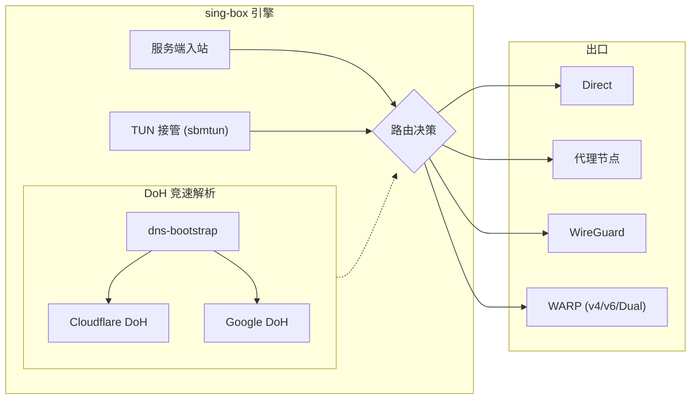

&lt;div align=&quot;center&quot;&gt;

# S-Singbox-Manager

**单文件 Bash · `sing-box` 交互式运维管理器**

[](https://github.com/88860/S-Singbox-Manager)
[](https://www.gnu.org/software/bash/)
[](https://github.com/SagerNet/sing-box)
[](#安装与运行)
[](#运行机制)

**简体中文** | [English](README_EN.md)

[安装与运行](#安装与运行) · [功能概览](#功能概览) · [协议与证书](#协议与证书) · [运行机制](#运行机制) · [菜单与目录](#菜单与目录)

&lt;/div&gt;

---

## 简介

`S-Singbox-Manager`（快捷命令 `s`）是基于 `sing-box` 内核的纯 Bash 单文件运维脚本，覆盖服务端多协议入站、客户端 TUN 全局接管、用户态 WireGuard、Cloudflare WARP 出口、ACME 自动证书及流媒体/AI/CDN 解锁检测。

> [!IMPORTANT]
> **环境要求**：Root 权限、`apt` + `systemd`（Debian / Ubuntu）、`sing-box` 内核 ≥ `v1.14.0`（首次运行自动安装最新版），支持纯 IPv4、纯 IPv6 及双栈网络。

---

## 安装与运行

```bash
curl -fsSL https://raw.githubusercontent.com/88860/S-Singbox-Manager/main/s.sh -o /root/s.sh && chmod 700 /root/s.sh && bash /root/s.sh
```

首次运行将自动补齐基础依赖（`curl` / `tar` / `jq` / `openssl` / `nftables`）、下载对应架构的 `sing-box`（SHA-256 校验）、配置 `systemd` 服务，并创建软链接 `/usr/local/bin/s`。

| 命令 | 说明 |
| :--- | :--- |
| `s` | 打开交互式主菜单 |
| `s -v` / `s --version` | 显示脚本版本（`s v26.11.28`） |

---

## 功能概览

| 模块 | 能力说明 |
| :--- | :--- |
| **服务端管理** | 创建、修改、删除 9 大类 / 15 种协议组合；按域名或公网 IPv4 / IPv6 生成标准分享链接；端口占用与 SSH 端口冲突保护 |
| **客户端接管** | 解析主流协议 URI 导入节点（含防自环校验）；并发测速列表支持回车刷新；通过 `sbmtun` 实现 TUN 全局接管并同步 `systemd-resolved` 路由 |
| **WireGuard** | 基于 `sing-box` 用户态 `endpoints`（MTU `1408`）；支持服务端多客户端管理与自动双栈网段分配，以及客户端出口接管与延迟探测 |
| **Cloudflare WARP** | 自动注册与凭据刷新；支持 IPv4 / IPv6 / 双栈独立接管；内置 Endpoint 优选与 `cdn-cgi/trace` 生效验证（失败自动回滚） |
| **解锁与 CDN 检测** | 双栈并发探测 14 项目标：AI（ChatGPT / Claude / Gemini / Grok）、流媒体（Netflix / Disney+ / YouTube Premium / Spotify）、CDN（YouTube / Cloudflare / CloudFront / Fastly / Bunny / Gcore） |
| **更新与卸载** | 在线检测并更新 `sing-box` 内核（SHA-256 校验）与 `s.sh`（Git Blob SHA-1 + `bash -n` 校验）；支持一键卸载服务、规则、配置及脚本安装的依赖包 |

---

## 协议与证书

### 服务端入站协议

| 协议 | 支持形态与参数 | 传输层 | 安全与证书 |
| :--- | :--- | :--- | :--- |
| **VLESS** | Reality (`xtls-rprx-vision`)、TLS (`xtls-rprx-vision`)、WS + TLS、gRPC + TLS | TCP | Reality 自动探测目标域名 TLS 1.3 / h2 / X25519；其余使用 ACME |
| **Trojan** | TLS、WS + TLS、gRPC + TLS | TCP | ACME |
| **Hysteria2** | BBR（`conservative`/`standard`/`aggressive`）/ Brutal 带宽；Salamander / Gecko 混淆；`nftables` 端口跳跃 | UDP | ACME + ALPN `h3` |
| **TUIC** | v5、`bbr`/`cubic`/`new_reno`、`native` UDP 中继 | UDP | ACME + ALPN `h3` |
| **Shadowsocks** | 2022（`AES-128-GCM` / `AES-256-GCM` / `ChaCha20-Poly1305`）与 AEAD，内置 Multiplex | TCP + UDP | 密钥长度校验 |
| **VMess** | TLS、WS + TLS、gRPC + TLS、HTTP + TLS | TCP | ACME |
| **AnyTLS** | TLS + 可选 `client_metadata` | TCP | ACME |
| **SOCKS5** | 用户名与密码鉴权 | TCP | 账密鉴权 |
| **Snell** | v6、PSK（12–255 字节）、流量整形（`default` / `unshaped` / `unsafe-raw`） | TCP | PSK |

### ACME 证书验证方式

采用 `sing-box` 1.14+ 顶层 `certificate_providers` 统一签发与管理：

| 方式 | 端口要求 | 说明 |
| :--- | :--- | :--- |
| **HTTP-01** | TCP `80` | 默认方式，单域名自动签发 |
| **TLS-ALPN-01** | TCP `443` | 80 端口不可用时使用 |
| **Cloudflare DNS** | 无 | 使用 Cloudflare API Token 进行 DNS-01 验证 |
| **阿里云 DNS** | 无 | 使用 AccessKeyId / AccessKeySecret 进行 DNS-01 验证 |
| **ACME-DNS** | 无 | 使用 ACME-DNS 接口凭据进行 DNS-01 验证 |

---

## 运行机制



- **配置规范**：遵循 `sing-box` 1.14 / 1.15 标准，使用顶层 `certificate_providers`、TUN `dns_mode: "hijack"`（省略已废弃的 `stack`）、路由规则动作（`hijack-dns` / `sniff` / `resolve` / `bypass` / `reject`）及 DNS `evaluate` / `match_response` / `race` 竞速解析。
- **原子变更与回滚**：通过 `flock` 互斥锁、`sing-box check` 预检、`0600` 原子替换管理配置；重启异常或端口跳跃同步失败自动回滚至上一版本。
- **更换域名事务**：更换域名时拉起独立临时实例预签发并校验新证书，完成后再切换正式配置，失败自动恢复旧状态。
- **SSH 防失联**：启用 TUN 全局接管时，路由规则自动绕过当前 SSH 客户端 IP、本机 SSH 监听端口、`sshd`/`dropbear` 进程及本机网卡地址。
- **权限与日志**：`systemd` 服务仅授予必要 Capabilities 并启用 `NoNewPrivileges=true`；日志统一由 `systemd-journald` 管理。

---

## 菜单与目录

&lt;details&gt;
&lt;summary&gt;&lt;b&gt;交互菜单结构&lt;/b&gt;&lt;/summary&gt;

```text
s 管理器 v26.11.28
├── 1. 服务端管理
│   ├── 1. 创建协议
│   ├── 2. 删除协议
│   ├── 3. 修改配置
│   ├── 4. 服务端信息
│   ├── 5. 更换域名
│   ├── 6. 重启服务
│   └── 7. 停止服务
├── 2. 客户端管理
│   ├── 1. 添加节点
│   ├── 2. 节点选择 (回车刷新测速)
│   ├── 3. 删除节点 (回车刷新测速)
│   ├── 4. 停止代理
│   └── 5. 客户端状态
├── 3. WireGuard 管理
│   ├── 1. 初始化配置
│   ├── 2. 修改配置
│   ├── 3. 启用/停用
│   ├── 4. 状态信息
│   └── 5. 删除配置
├── 4. WARP 管理
│   ├── 1. 获取出口 IP
│   ├── 2. 查看 WARP 配置
│   ├── 3. 启用/停用 WARP
│   └── 4. 删除配置
└── 5. 状态与更新
    ├── 1. 解锁查询
    ├── 2. 检测更新
    └── 3. 彻底卸载
```

&lt;/details&gt;

&lt;details&gt;
&lt;summary&gt;&lt;b&gt;核心文件路径&lt;/b&gt;&lt;/summary&gt;

| 路径 | 用途 |
| :--- | :--- |
| `/root/s.sh` | 脚本本体（`0700`） |
| `/usr/local/bin/s` | 全局快捷命令软链接 |
| `/usr/local/bin/sing-box` | `sing-box` 二进制文件 |
| `/etc/sing-box/config.json` | 运行配置（`0600`） |
| `/etc/sbm/nodes/*.json` | 服务端节点配置 |
| `/etc/sbm/peers/*.json` | 客户端节点配置 |
| `/etc/sbm/wg/local.json` | WireGuard 配置 |
| `/etc/sbm/warp/config.json` | WARP 配置 |
| `/etc/sbm/acme/` | ACME 证书目录 |
| `/etc/sbm/state.json` | 全局出口与域名状态 |
| `/etc/sbm/apt_installed` | 脚本安装的 apt 包记录 |
| `/etc/systemd/system/sing-box.service` | `systemd` 服务单元 |

&lt;/details&gt;

&lt;details&gt;
&lt;summary&gt;&lt;b&gt;日志查看与 journald 限额&lt;/b&gt;&lt;/summary&gt;

查看实时日志：

```bash
journalctl -u sing-box -f --no-pager
```

限制 `journald` 占用（示例：`50M` / `7 天`）：

```bash
mkdir -p /etc/systemd/journald.conf.d
cat > /etc/systemd/journald.conf.d/size.conf <<'EOF'
[Journal]
SystemMaxUse=50M
MaxRetentionSec=7day
EOF
systemctl restart systemd-journald
```

&lt;/details&gt;

> [!TIP]
> 如需彻底卸载，进入菜单选择 **`5. 状态与更新` → `3. 彻底卸载`** 即可停止服务、清理 `nftables` 端口跳跃表与配置目录，并按需移除脚本安装的依赖包。