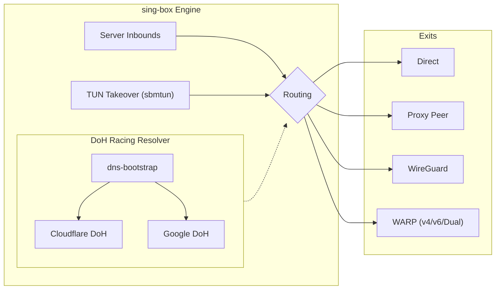

&lt;div align=&quot;center&quot;&gt;

# S-Singbox-Manager

Single-file Bash interactive manager for `sing-box`

[](https://github.com/88860/S-Singbox-Manager)
[](https://www.gnu.org/software/bash/)
[](https://github.com/SagerNet/sing-box)
[](#installation)

[简体中文](README.md) | **English**

[Installation](#installation) · [Features](#features) · [Protocols & Certificates](#protocols--certificates) · [Architecture](#architecture) · [Menu & Files](#menu--files)

&lt;/div&gt;

---

## Overview

`S-Singbox-Manager` (shortcut `s`) is a single-file Bash script for operating `sing-box`. It manages multi-protocol server inbounds, client-side global TUN routing, userspace WireGuard, Cloudflare WARP exits, automated ACME certificates, and streaming/AI/CDN unlock checks.

> [!IMPORTANT]
> **Requirements**: Root access, `apt` + `systemd` (Debian / Ubuntu), and `sing-box` ≥ `v1.14.0` (installed automatically on first run). Supports IPv4-only, IPv6-only, and dual-stack networks.

---

## Installation

```bash
curl -fsSL https://raw.githubusercontent.com/88860/S-Singbox-Manager/main/s.sh -o /root/s.sh && chmod 700 /root/s.sh && bash /root/s.sh
```

On first run, the script installs missing base packages (`curl`, `tar`, `jq`, `openssl`, `nftables`), downloads the latest architecture-matched `sing-box` binary with SHA-256 verification, configures the `systemd` unit, and links `/usr/local/bin/s`.

| Command | Description |
| :--- | :--- |
| `s` | Open the interactive menu |
| `s -v` / `s --version` | Print script version (`s v26.11.28`) |

---

## Features

| Module | Capabilities |
| :--- | :--- |
| **Server Management** | Create, edit, and delete 9 protocol families / 15 combinations; generate share URIs by domain or public IPv4/IPv6; port conflict and SSH port protection |
| **Client Takeover** | Import nodes from standard proxy URIs with anti-loopback validation; concurrent latency probing with Enter-to-refresh; global TUN routing (`sbmtun`) with `systemd-resolved` sync |
| **WireGuard** | Userspace `sing-box` `endpoints` (MTU `1408`); server mode with multi-client management and automatic dual-stack subnet allocation; client mode with tunnel latency probing |
| **Cloudflare WARP** | Account registration and credential refresh; independent IPv4 / IPv6 / dual-stack exit modes; endpoint selection and `cdn-cgi/trace` verification with automatic rollback on failure |
| **Unlock & CDN Checks** | Concurrent dual-stack probing of 14 targets: AI (ChatGPT, Claude, Gemini, Grok), streaming (Netflix, Disney+, YouTube Premium, Spotify), and CDN PoPs (YouTube, Cloudflare, CloudFront, Fastly, Bunny, Gcore) |
| **Update & Uninstall** | Online updates for `sing-box` (SHA-256 verified) and `s.sh` (Git Blob SHA-1 + `bash -n` verified); full uninstallation of service, firewall rules, configs, and script-installed apt packages |

---

## Protocols & Certificates

### Server Inbound Protocols

| Protocol | Variants & Options | Transport | Security / TLS |
| :--- | :--- | :--- | :--- |
| **VLESS** | Reality (`xtls-rprx-vision`), TLS (`xtls-rprx-vision`), WS + TLS, gRPC + TLS | TCP | Reality auto-probes target TLS 1.3 / h2 / X25519; others use ACME |
| **Trojan** | TLS, WS + TLS, gRPC + TLS | TCP | ACME |
| **Hysteria2** | BBR (`conservative`/`standard`/`aggressive`) or Brutal bandwidth; Salamander / Gecko obfs; `nftables` port hopping | UDP | ACME + ALPN `h3` |
| **TUIC** | v5, `bbr`/`cubic`/`new_reno`, `native` UDP relay | UDP | ACME + ALPN `h3` |
| **Shadowsocks** | 2022 (`AES-128-GCM` / `AES-256-GCM` / `ChaCha20-Poly1305`) and AEAD with Multiplex | TCP + UDP | Key length validation |
| **VMess** | TLS, WS + TLS, gRPC + TLS, HTTP + TLS | TCP | ACME |
| **AnyTLS** | TLS + optional `client_metadata` | TCP | ACME |
| **SOCKS5** | Username and password authentication | TCP | Credentials |
| **Snell** | v6, PSK (12–255 bytes), traffic shaping (`default` / `unshaped` / `unsafe-raw`) | TCP | PSK |

### ACME Challenge Methods

Certificates are managed via `sing-box` 1.14+ top-level `certificate_providers`:

| Method | Port Required | Notes |
| :--- | :--- | :--- |
| **HTTP-01** | TCP `80` | Default single-domain issuance |
| **TLS-ALPN-01** | TCP `443` | Alternative when port 80 is unavailable |
| **Cloudflare DNS** | None | DNS-01 via Cloudflare API Token |
| **AliDNS** | None | DNS-01 via AccessKeyId / AccessKeySecret |
| **ACME-DNS** | None | DNS-01 via ACME-DNS credentials |

---

## Architecture



- **Modern sing-box Schema**: Compliant with `sing-box` 1.14 / 1.15 using top-level `certificate_providers`, TUN `dns_mode: "hijack"` (omitting deprecated `stack`), route rule actions (`hijack-dns`, `sniff`, `resolve`, `bypass`, `reject`), and DNS `evaluate` / `match_response` / `race`.
- **Atomic Updates & Rollback**: Protected by `flock`, `sing-box check` validation, and `0600` atomic file replacement; failed restarts or port-hopping sync automatically roll back to the previous config.
- **Zero-Downtime Domain Switching**: Spins up an isolated temporary instance to issue and verify the new certificate before switching production config; rolls back automatically on error.
- **SSH Lockout Prevention**: When TUN takeover is active, routing rules bypass the active SSH client IP, local SSH listening ports, `sshd`/`dropbear` processes, and local interface addresses.
- **Privileges & Logging**: The `systemd` unit grants only required capabilities with `NoNewPrivileges=true`; logs are handled by `systemd-journald`.

---

## Menu & Files

&lt;details&gt;
&lt;summary&gt;&lt;b&gt;Interactive Menu Structure&lt;/b&gt;&lt;/summary&gt;

```text
s Manager v26.11.28
├── 1. Server Management
│   ├── 1. Create Protocol
│   ├── 2. Delete Protocol
│   ├── 3. Edit Config
│   ├── 4. Server Info
│   ├── 5. Change Domain
│   ├── 6. Restart Service
│   └── 7. Stop Service
├── 2. Client Management
│   ├── 1. Add Node
│   ├── 2. Select Node (Enter to refresh latency)
│   ├── 3. Delete Node (Enter to refresh latency)
│   ├── 4. Stop Proxy
│   └── 5. Client Status
├── 3. WireGuard Management
│   ├── 1. Initialize Config
│   ├── 2. Edit Config
│   ├── 3. Enable / Disable
│   ├── 4. Status
│   └── 5. Delete Config
├── 4. WARP Management
│   ├── 1. Get Exit IP
│   ├── 2. View WARP Config
│   ├── 3. Enable / Disable WARP
│   └── 4. Delete Config
└── 5. Status & Updates
    ├── 1. Unlock Check
    ├── 2. Check Updates
    └── 3. Uninstall
```

&lt;/details&gt;

&lt;details&gt;
&lt;summary&gt;&lt;b&gt;File Layout&lt;/b&gt;&lt;/summary&gt;

| Path | Purpose |
| :--- | :--- |
| `/root/s.sh` | Main script (`0700`) |
| `/usr/local/bin/s` | Global shortcut symlink |
| `/usr/local/bin/sing-box` | `sing-box` binary |
| `/etc/sing-box/config.json` | Generated runtime config (`0600`) |
| `/etc/sbm/nodes/*.json` | Server inbound node configs |
| `/etc/sbm/peers/*.json` | Client outbound node configs |
| `/etc/sbm/wg/local.json` | WireGuard config |
| `/etc/sbm/warp/config.json` | Cloudflare WARP config |
| `/etc/sbm/acme/` | ACME certificates directory |
| `/etc/sbm/state.json` | Global exit and domain state |
| `/etc/sbm/apt_installed` | Packages installed by the script |
| `/etc/systemd/system/sing-box.service` | `systemd` service unit |

&lt;/details&gt;

&lt;details&gt;
&lt;summary&gt;&lt;b&gt;Logs &amp; journald Limits&lt;/b&gt;&lt;/summary&gt;

Stream live logs:

```bash
journalctl -u sing-box -f --no-pager
```

Cap `journald` disk usage (example: `50M` / `7 days`):

```bash
mkdir -p /etc/systemd/journald.conf.d
cat > /etc/systemd/journald.conf.d/size.conf <<'EOF'
[Journal]
SystemMaxUse=50M
MaxRetentionSec=7day
EOF
systemctl restart systemd-journald
```

&lt;/details&gt;
